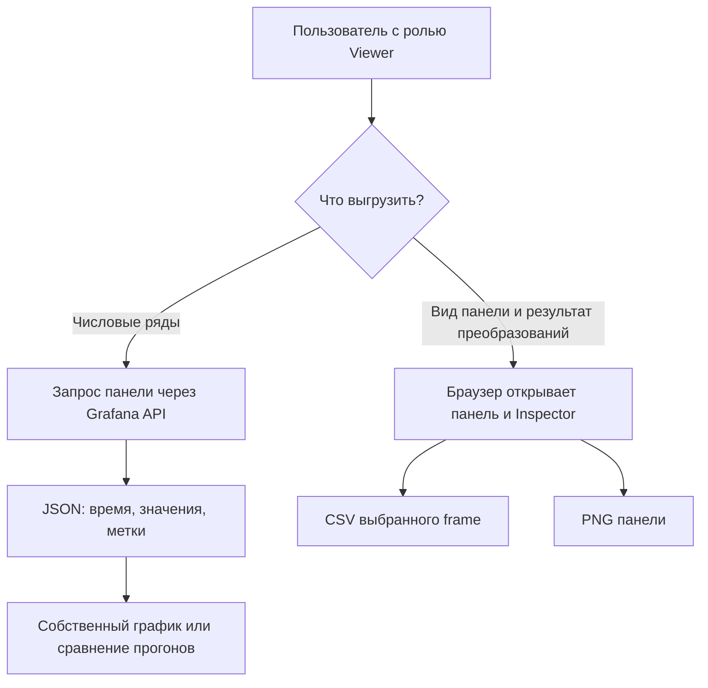
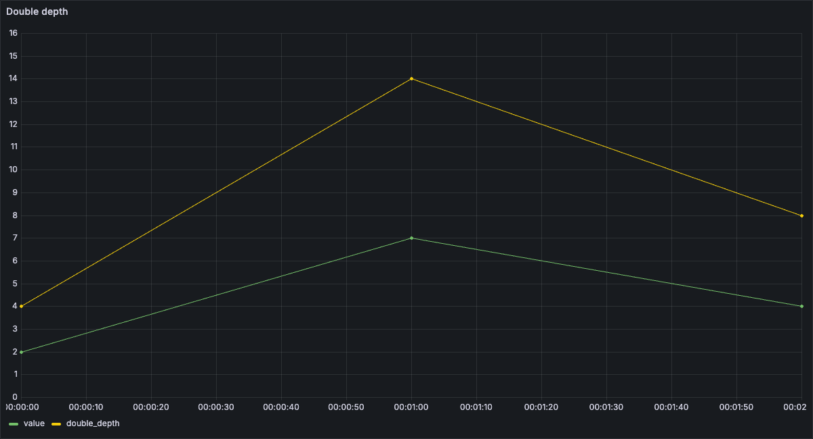
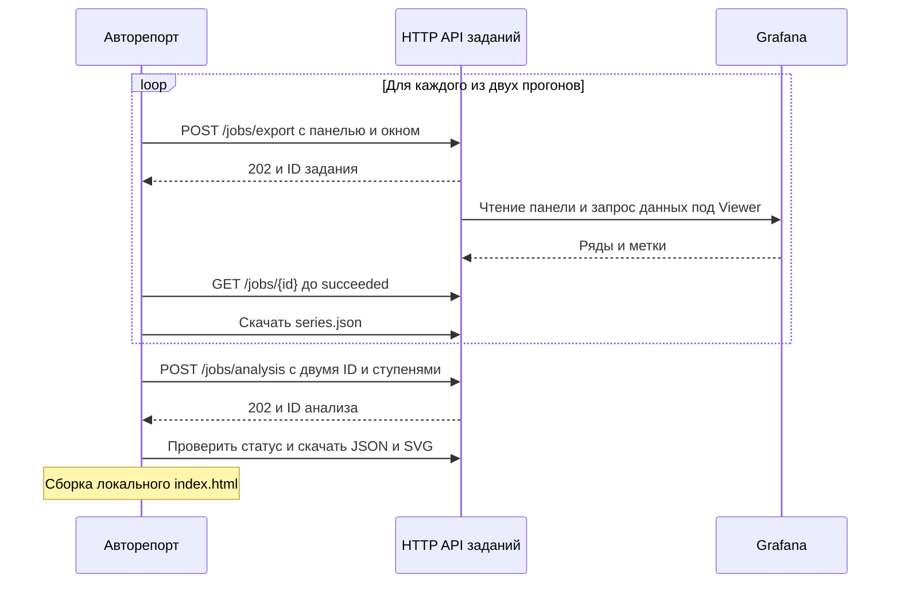
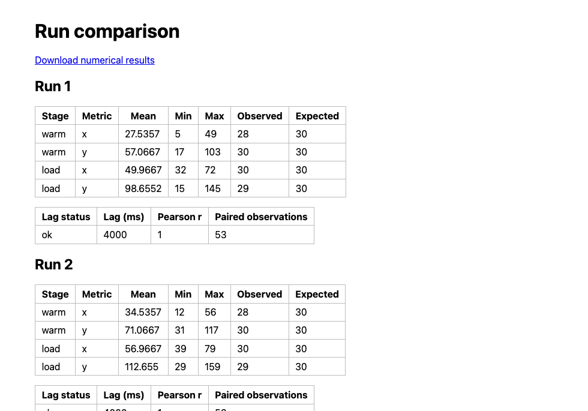
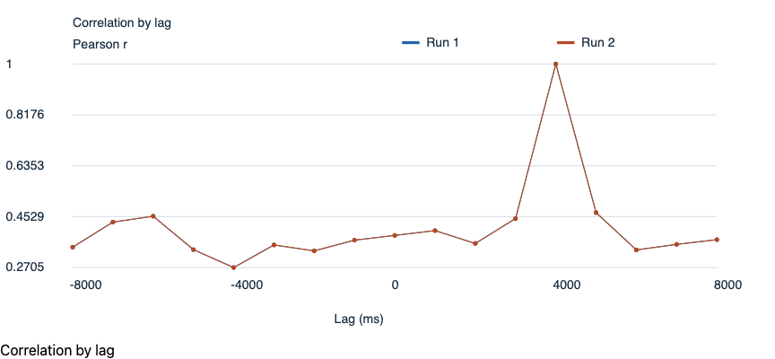

# От панели Grafana до автономного отчёта

## Какой результат нужен?

В обоих сценариях экспортёр обращается к Grafana. Запрос к Prometheus или InfluxDB выполняет сама Grafana. В числовом экспорте доступны данные запросов панели. Для панели с преобразованиями используйте [браузерный экспорт](../BROWSER.md).

### Что видит Viewer

Снимок сделан экспортёром на Grafana 11.5.2. У исходного ряда три значения — 2, 7 и 4. В панели настроено умножение на два. Из Inspector скачан CSV с полем `double_depth` и значениями 4, 14 и 8. Это проверяется сравнением всех трёх строк в тесте.

## Как строится авторепорт

Окна задаются в Unix-миллисекундах. При ошибке отдельного запроса в скачанном JSON остаётся его статус, а успешные ряды доступны для анализа. Клиент авторепорта использует адрес HTTP API. Viewer-токен находится у сервиса. [Контракт и примеры запросов](../HTTP_API.md).

### Как читать результат

Следующие два снимка сделаны с отключённой сетью на **отдельном примере с известной задержкой**. В нём два прогона по 60 секунд. В каждом прогоне метрика y следует за x на четыре секунды.

В первом прогоне на ступени warm собрано 28 из 30 ожидаемых значений x. На ступени load собрано 29 из 30 значений y. Таблица лага показывает 4000 мс по 53 парам наблюдений.

Ось X — сдвиг в миллисекундах, ось Y — коэффициент корреляции Пирсона. У обоих прогонов максимум равен 1 при +4000 мс. Кривые накладываются, поскольку постоянная прибавка к значениям второго прогона сохраняет корреляцию.

## Как воспроизвести

Из корня репозитория запустите `bash integration/quickstart.sh`. Откройте `known-lag/index.html` в выведенном каталоге для просмотра примера с лагом. Файл `stores/http/index.html` содержит отдельный отчёт, построенный из живых экспортов Prometheus и InfluxDB через Grafana.

Для повторения снимка панели установите [браузерные зависимости](../BROWSER.md) и выполните `BROWSER_CHECK=1 BROWSER_CHANNEL=chrome GRAFANA_VERSION=11.5.2 python demo.py /tmp/panel2series-visual-demo` в новом каталоге вывода. Файлы panel.png и panel.csv появятся рядом.
